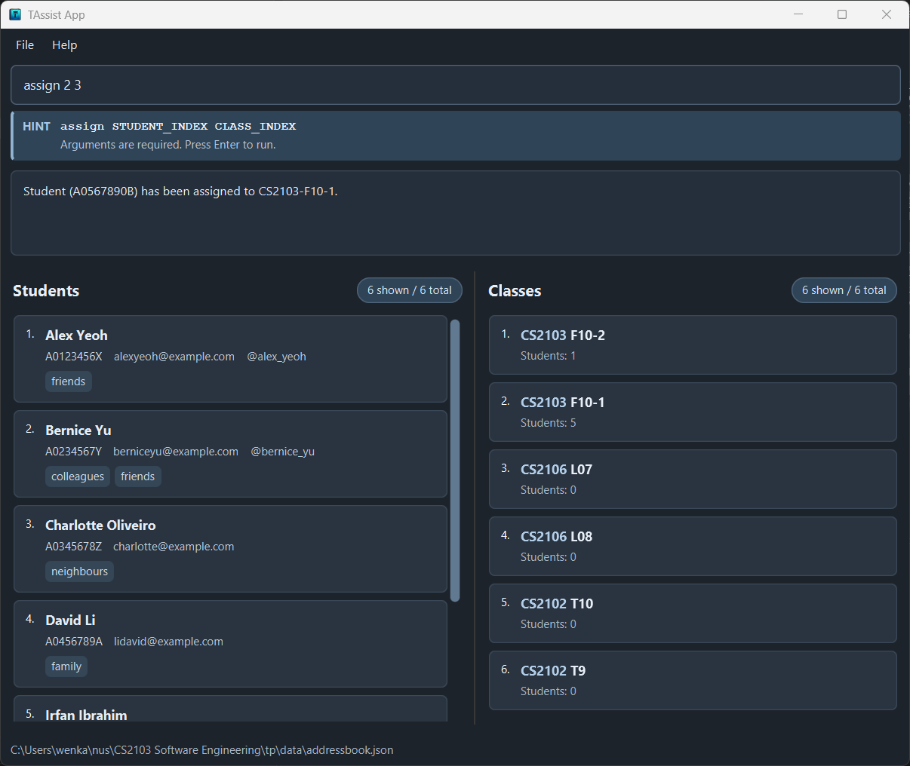
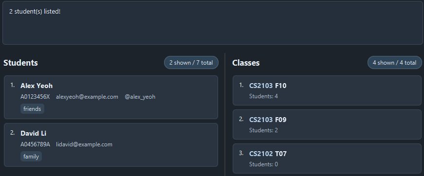

# TAssist User Guide

TAssist is a **desktop application for NUS Teaching Assistants who need to manage the students they tutor, optimized for use through a Command Line Interface (CLI)** while retaining the benefits of a Graphical User Interface (GUI). It gives TAs quick access to student contacts and information, helping them manage student learning outcomes from a central application.

<!-- * Table of Contents -->
<page-nav-print />

--------------------------------------------------------------------------------------------------------------------

## Quick start

1. Ensure that Java `25` or later is installed on your computer.<br>
   **Mac users:** Ensure you have the precise JDK version prescribed [here](https://se-education.org/guides/tutorials/javaInstallationMac.html).

1. Download the latest `.jar` file from [here](https://github.com/AY2627S1-CS2103-F10-2/tp/releases).

1. Copy the file to the folder you want to use as the _home folder_ for TAssist.

1. Open a terminal, `cd` to the folder containing the JAR file, and run `java -jar TAssist.jar`.<br>
   A GUI similar to the one below should appear in a few seconds. The app shows students and classes in separate sections.<br>
   

1. Type a command in the command box and press Enter to execute it. For example, type **`help`** and press Enter to open the help window.<br>
   Some example commands you can try:

   * `list` : Lists all students.

   * `add sn/A0123456X n/John Doe e/johnd@example.com tg/john_doe` : Adds a student named `John Doe`.

   * `addclass m/CS2103T c/F10-2` : Creates a class named `F10-2` for module `CS2103T`.

   * `listclass` : Lists all classes.

   * `listbystudent 1` : Lists the classes assigned to the 1st student shown in the current student list.

   * `delete 3` : Deletes the 3rd student shown in the current list.

   * `deleteclass m/CS2103T c/F10-2` : Deletes the class named `F10-2` for module `CS2103T`.

   * `clear` : Deletes all students and classes.

   * `exit` : Exits the app.

1. Refer to the [Features](#features) section below for details of each command.

--------------------------------------------------------------------------------------------------------------------

## Features

### Recalling previous commands

In the command box, press **Up/Down** arrows to browse the latest **20 successful commands** from this app session.

Edits of past commands are kept while browsing and cleared when you submit a command. Failed input remains as your draft.

<box type="info" seamless>

**Notes about the command format:**<br>

* Words in `UPPER_CASE` are the parameters to be supplied by the user.<br>
  For example, in `add sn/STUDENT_NUMBER n/NAME`, replace `STUDENT_NUMBER` with a value such as `A0123456X` and `NAME` with a value such as `John Doe`.

* Items in square brackets are optional.<br>
  For example, `n/NAME [t/TAG]` can be used as `n/John Doe t/friend` or as `n/John Doe`.

* Items followed by `...` can appear zero or more times.<br>
  For example, `[t/TAG]... ` may be omitted, or written as `t/friend` or `t/friend t/family`.

* Parameters can be in any order.<br>
  For example, if the command specifies `sn/STUDENT_NUMBER n/NAME e/EMAIL`, `e/EMAIL sn/STUDENT_NUMBER n/NAME` is also acceptable.

* Prefixes identify the kind of information you are providing.<br>
  For example, `n/` is used for student names, `m/` for module codes, and `c/` for class names.

* Repeated prefixes are accepted only when the command explicitly allows multiple values.<br>
  For example, `add` and `edit` accept multiple `t/TAG` values, but `addclass` and `deleteclass` accept exactly one `m/MODULE_CODE` and one `c/CLASS_NAME`.

* Extraneous parameters for commands that take no parameters, such as `help`, `list`, `exit`, and `clear`, are ignored.<br>
  For example, `help 123` is interpreted as `help`.

* If you are using a PDF version of this document, be careful when copying and pasting commands that span multiple lines as space characters surrounding line-breaks may be omitted when copied over to the application.
</box>

### Viewing help: `help`

Shows a message explaining how to access the help page.


Format: `help`


### Adding a student: `add`

Adds a student to TAssist.

Format: `add sn/STUDENT_NUMBER n/NAME e/EMAIL [tg/TELEGRAM] [t/TAG]... `

<box type="tip" seamless>

**Tip:** A student can have any number of tags, including zero. Tags are supported by this build although they are not part of the current MVP feature list.
</box>

* `STUDENT_NUMBER` must contain 5 to 20 letters or digits, with no spaces or special characters. It is stored and displayed in uppercase, and must be unique.
* `NAME` must contain only letters, digits, and spaces, and must start with a letter or digit. Leading and trailing spaces are removed.
* `EMAIL` must be in the format `local-part@domain`, with no spaces. Email comparisons are case-insensitive for duplicate checks.
* `TELEGRAM`, if provided, may start with `@`. After removing `@`, it must contain 5 to 32 letters, digits, or underscores. It must be unique, ignoring case.
* Parameters can be supplied in any order.

Examples:
* `add sn/A0123456X n/Alice Tan e/alice@u.nus.edu tg/alice_tan`
* `add sn/A0234567Y n/Benjamin Lim e/benjamin@u.nus.edu`
* `add e/chloe@u.nus.edu sn/A0345678Z tg/@chloe_ng n/Chloe Ng`

Expected output:
* `New person added: Alice Tan; Student Number: A0123456X; Email: alice@u.nus.edu; Telegram: @alice_tan; Tags:`

Common errors:
* Duplicate student number: `A student with this student number already exists.`
* Duplicate email: `A student with this email already exists.`
* Duplicate Telegram username: `A student with this Telegram username already exists.`
* Invalid student number: `Invalid student number. Student numbers must contain 5–20 letters or digits with no spaces.`
* Invalid name: `Names should only contain alphanumeric characters and spaces, and should not be blank`
* Invalid Telegram username: `Invalid Telegram username. Usernames must contain 5–32 letters, digits, or underscores.`

### Listing all students: `list`

Shows a list of all students in TAssist.

Format: `list`

Expected output: `Listed all persons.`

The student list displays each student's name, student number, email, optional Telegram username, and tags.
This command leaves the current class filter unchanged. Use `listclass` to restore all classes as well.

### Listing students by class: `listbyclass`

Shows only students assigned to the class at the specified displayed index, alphabetically by name using the existing
student cards.
Each card also shows the dates on which that student attended the class.
Optionally, specify `t/THRESHOLD` to filter for class members with fewer than `THRESHOLD` recorded attendance dates in that class.

Format: `listbyclass INDEX [t/THRESHOLD]`

* `INDEX` must be a positive integer referring to a class in the displayed class list.
* `THRESHOLD` (optional) must be a positive integer.
  * When `t/THRESHOLD` is provided, only students assigned to the selected class with **fewer than `THRESHOLD` recorded attendance dates** for that class are displayed.
  * Students with no recorded attendance for that class count as having `0` attendance dates (for example, `t/1` displays only students with `0` recorded dates, and `t/5` displays students with `0` to `4` recorded dates while excluding students with `5` or more dates).
  * Attendance recorded for other classes does not affect the count for the selected class.
  * Omitting `t/THRESHOLD` lists all students assigned to the class and clears any active attendance threshold restriction.
* The class list index is independent of the student list index.
* An invalid or out-of-range index or threshold is rejected without changing the student list.
* Names are sorted ignoring case, with original spelling used to break ties.
* Adding or deleting attendance dates, or assigning/unassigning students, immediately updates the displayed list against the active class and threshold filter.
* An existing class with no matching students shows an empty student list and a count of zero.
* Deleting the class currently being displayed empties the student list without deleting student records.
  If you recreate the class, subsequent assignments update this view using the new class membership.
* Renaming the class currently being displayed with `editclass` preserves both the class view and any active `t/THRESHOLD` attendance filter.
* This command changes only the displayed student list, not student records, class memberships, or the class list.
* Use `list` to show all students again. `list` and `find` display results in their original insertion order.

Examples:

* Check the class list displayed in the UI, then run `listbyclass 1` to list all students in the 1st displayed class, or `listbyclass 1 t/5` to list only students in the 1st displayed class with fewer than 5 recorded attendance dates.

The result message includes the student count and class (and the threshold when specified), for example:
* `Listed 2 students taking CS2103 (F10-2).`
* `Listed 1 students taking CS2103 (F10-2) with fewer than 5 recorded attendance dates.`

Classes created with `addclass` start empty. Use `assign sn/STUDENT_NUMBER m/MODULE_CODE c/CLASS_NAME`
to assign an existing student before listing the class. Memberships are saved across restarts.

Example walkthrough (use unused student numbers, email addresses, and a new class):

```text
add sn/A0999901X n/Zoe Test e/zoe.test@example.com
add sn/A0999902Y n/Amy Test e/amy.test@example.com
addclass m/CS2103 c/TEST-103
assign sn/A0999901X m/CS2103 c/TEST-103
assign sn/A0999902Y m/CS2103 c/TEST-103
listbyclass 1
```

The student list shows only Amy Test followed by Zoe Test, with the message
`Listed 2 students taking CS2103 (TEST-103).` Other students and the class list are unchanged.
After closing and reopening TAssist, check the class list and run `listbyclass 1` again to display the saved
memberships alphabetically. The filtered view itself is not saved. Run `list` to return to all students.

Editing a student updates their existing class memberships. Deleting a student removes their memberships
while retaining the classes and other students.

### Listing classes by student: `listbystudent`

Shows the classes assigned to the student at the specified index in the displayed student list.
Matching classes appear in the **Classes** panel. The feedback message reports their count and the selected student's
name and student number.

Format: `listbystudent INDEX`

* `INDEX` must be a positive integer shown beside a student in the current Students panel.
  After `find` or `listbyclass`, use the index in those results, not the student's original index.
* The Classes panel shows all of that student's classes, in class creation order, even if classes were previously filtered.
  Classes assigned only to other students and classes with no students are excluded.
* A student with no assigned classes produces an empty Classes panel and a count of zero.
* The displayed student list, student records, and memberships are unchanged.
* The class view updates after assignments, unassignments, and edits to the selected student's number.
  Deleting the selected student empties this view without deleting classes.
* Changing the student search with `find` does not change the selected student's class view.
  Run `listbystudent` again to select a student from the new search results.
* Use `listclass` to show all classes again. `list` restores the student list only.
* The filter is not saved across restarts; memberships are saved.

Examples:

* `listbystudent 1` shows classes for the first student in the current student list.
* `find AlphaDemoAlice`, followed by `listbystudent 1`, shows classes for the first student in that search result.

**Example walkthrough**

Use unused student numbers, email addresses, and module/class pairs for this walkthrough. Enter each command separately.
If you already created these demonstration records, reuse them and skip the corresponding creation commands.

```text
add sn/A0999801X n/AlphaDemoAlice e/alpha.demo.alice@example.com
add sn/A0999802Y n/AlphaDemoBob e/alpha.demo.bob@example.com
addclass m/CS2103 c/DEMO-T01
addclass m/CS2100 c/DEMO-L01
addclass m/CS2106 c/DEMO-BOB
addclass m/CS2103 c/DEMO-EMPTY
assign sn/A0999801X m/CS2103 c/DEMO-T01
assign sn/A0999801X m/CS2100 c/DEMO-L01
assign sn/A0999802Y m/CS2106 c/DEMO-BOB
find AlphaDemoAlice
listbystudent 1
```

Expected feedback: `Listed 2 classes for AlphaDemoAlice (A0999801X).`
The Classes panel shows `CS2103 DEMO-T01` followed by `CS2100 DEMO-L01`.
Bob's `CS2106 DEMO-BOB` class and the empty `CS2103 DEMO-EMPTY` class are hidden.
The Students panel still shows Alice's search result.

To select Bob instead, run:

```text
find AlphaDemoBob
listbystudent 1
```

Only `CS2106 DEMO-BOB` appears. Bob is index `1` in the search results, regardless of his index before searching.

To check a student with no memberships and see the view update automatically, run:

```text
unassign sn/A0999802Y m/CS2106 c/DEMO-BOB
listbystudent 1
```

The Classes panel becomes empty after unassignment. The listing command reports:
`Listed 0 classes for AlphaDemoBob (A0999802Y).`
Restore the assignment with `assign sn/A0999802Y m/CS2106 c/DEMO-BOB`; Bob's class reappears automatically.

**Common errors**

| Input | Expected result |
| --- | --- |
| `listbystudent`, `listbystudent 0`, `listbystudent -1`, or `listbystudent abc` | Invalid command format, followed by the usage and an example. Supply one positive integer. |
| `listbystudent 1 extra` | Invalid command format. Extra arguments are rejected. |
| `listbystudent 2` when only one student is displayed | `The person index provided is invalid.` Use an index visible in the Students panel. |

Rejected commands preserve both displayed lists. Selecting a valid student with no classes is a successful operation.

### Listing all classes: `listclass`

Shows all academic classes in creation order and clears the class filter set by `listbystudent`.
The displayed student list is unchanged.

Format: `listclass`

Expected output: `Listed all classes.` Extra arguments are rejected.

The student and class filters can be reset independently:

| Command | Students panel | Classes panel |
| --- | --- | --- |
| `list` | Shows all students | Keeps the current class filter |
| `listclass` | Keeps the current student filter | Shows all classes, including empty classes |

Run `list` followed by `listclass` to restore both complete lists.

### Creating a class: `addclass`

Creates an academic class. Created classes appear in the class list section of the UI.

Format: `addclass m/MODULE_CODE c/CLASS_NAME`

* `MODULE_CODE` is the module that the class belongs to.
* `CLASS_NAME` is the class name for that module.
* The `m/` and `c/` parameters can be supplied in any order.
* Each class is uniquely identified by its module code and class name pair.
* Duplicate classes with the same module code and class name are not allowed.
* Module codes and class names are normalized before being saved.
* `MODULE_CODE` must begin with a letter and contain only letters or digits.
* `CLASS_NAME` must contain at least one letter or digit, and may contain only letters, digits, or hyphens.

Examples:
* `addclass m/CS2103T c/F10-2`
* `addclass c/T24 m/ST2334`

Expected output:
* `New class added: CS2103T-F10-2`

Common errors:
* Missing module code: `Missing required parameter: m/MODULE_CODE`
* Missing class name: `Missing required parameter: c/CLASS_NAME`
* Repeated module code: `Parameter m/ was specified more than once.`
* Repeated class name: `Parameter c/ was specified more than once.`
* Unknown parameter: `Unknown parameter: PREFIX`
* Duplicate class: `A class with this name for this module already exists`
* Invalid module code: `Module code must contain letters or digits`
* Invalid class name: `Class names can only contain letters, digits, or '-'`

### Assigning a student to a class: `assign`

Assigns an existing student to an existing academic class.

Format: `assign sn/STUDENT_NUMBER m/MODULE_CODE c/CLASS_NAME`

* All three parameters are required and must be supplied exactly once. They can appear in any order.
* Leading and trailing spaces are removed from parameter values.
* Student numbers, module codes, and class names are matched case-insensitively. Hyphens matter: `F10` and `F-10` identify different classes.
* `STUDENT_NUMBER` must contain 5 to 20 letters or digits, without spaces or special characters.
* `MODULE_CODE` must begin with a letter and contain only letters or digits.
* `CLASS_NAME` must contain at least one letter or digit, and may contain only letters, digits, or hyphens.
* The student and class must already exist. A student hidden by the current search can still be assigned; assignment preserves the displayed student list.
* A student may belong to multiple classes. Repeating an assignment reports that the student is already assigned and leaves the membership unchanged.

Examples:
* `assign sn/A1111111H m/CS2103 c/F-10` assigns student `A1111111H` to class `F-10` for module `CS2103`.
* `assign c/ f10-2 sn/ a0234567y m/ cs2103t` assigns student `A0234567Y` to class `F10-2` for module `CS2103T`.

Expected output:
* `Student (A1111111H) has been assigned to CS2103-F-10.`

Common errors:
* Missing parameter: `You're missing some parameters. The correct format is assign sn/STUDENT_NUMBER m/MODULE_CODE c/CLASS_NAME`
* Student not found: `Student (A1234567H) cannot be found in the address book.`
* Class not found: `Class (CS2100-F10) cannot be found in the address book.`
* Student already assigned: `Student (A1234567H) is already assigned to class CS2101-L1.`
* Repeated parameter: `Multiple values specified for the following single-valued field(s):` followed by the repeated prefixes.
* Unknown parameter: `Unknown parameter: PREFIX`
* Unexpected text before the parameters: `Invalid command format!` followed by the command usage.
* Empty or invalid student number, module code, or class name: the corresponding validation error from `add` or `addclass`.

Rejected commands leave memberships and student counts unchanged.

### Recording attendance: `addattendance`

Records one attended date for a student in a particular module and class.

Format: `addattendance STUDENT_INDEX CLASS_INDEX d/YYYY-MM-DD`

* The student and class must exist, and the student must currently be assigned to that class.
* `STUDENT_INDEX` selects a student in the current displayed student list, including `find` and `listbyclass` results.
  `CLASS_INDEX` selects a class in the current displayed class list, including `listbystudent` results.
* Put the student index first and the class index second, followed by exactly one `d/` date.
  Both indices must be positive integers within their respective displayed lists.
  Missing, extra, zero, negative, non-integer and out-of-range indices are rejected.
* Check both displayed indices again after changing views, editing data or changing class membership,
  including when recalling an old command. The same indices may now refer to a different student or class.
* Student-number input (`sn/`), module/class prefixes (`m/`, `c/`) and other unknown prefixes are rejected.
  Extra whitespace between the indices and around the date is accepted.
* Use a valid calendar date with a year from `0001` to `9999`, a two-digit month and a two-digit day.
  Today and past dates are accepted; future dates are rejected using your computer's local date.
* Recording the same date twice for the same student and class is rejected without changing the existing record.
  Other students and classes have separate attendance histories.
* Recording attendance does not change your current student or class list view.
* Successful records are saved automatically and retained after restarting TAssist.
  Unassigning a student keeps their history, but new dates cannot be recorded until they are assigned again.
  Deleting the student or class removes the associated attendance history.

Example (after creating the student and class):

1. `assign sn/A0123456X m/CS2103 c/F10-2`
2. Run `list` and `listclass`. Check the student's index (assumed to be `1`) and the class's index (assumed to be `2`).
3. `addattendance 1 2 d/2024-02-29`

TAssist displays a confirmation message when the date is recorded. This command does not add an attendance display
to student cards.

### Removing attendance: `deleteattendance`

Removes one previously recorded date for a student in a particular module and class.

Format: `deleteattendance STUDENT_INDEX CLASS_INDEX d/YYYY-MM-DD`

* The student and class must still exist, and the specified date must already be recorded for that pair.
* The student does not need to be currently assigned to the class. You can correct retained history after unassignment.
  If the student disappeared from `listbyclass`, run `list`. If the class is hidden by `listbystudent`, run `listclass`.
  Use their newly displayed indices.
* `STUDENT_INDEX` selects a student in the current displayed student list, including `find` and `listbyclass` results.
  `CLASS_INDEX` selects a class in the current displayed class list, including `listbystudent` results.
* Put the student index first and the class index second, followed by exactly one `d/` date.
  Both indices must be positive integers within their respective displayed lists.
  Missing, extra, zero, negative, non-integer and out-of-range indices are rejected.
* Check both displayed indices again after changing views, editing data or changing class membership,
  including when recalling an old command. The same indices may now refer to a different student or class.
* Student-number input (`sn/`), module/class prefixes (`m/`, `c/`) and other unknown prefixes are rejected.
  Extra whitespace between the indices and around the date is accepted.
* Use a valid calendar date in `YYYY-MM-DD` format, with a year from `0001` to `9999`.
  An already-recorded date can be removed even if it appears future after a clock or timezone change.
  This does not allow future attendance to be added. Unrecorded future dates are rejected.
* An unrecorded date, including a date already removed, is rejected without changing existing data.
* Only the specified date is removed. Other attendance dates, students, classes, memberships and current views
  are unchanged. Removing the last date leaves an attendance count of zero.
* Successful removal is saved automatically and remains in effect after restarting TAssist.
  You can record the removed date again with `addattendance` if the student is currently assigned to the class.

Example (after recording attendance for student index `1` in class index `2` in the current displayed lists):

`deleteattendance 1 2 d/2024-02-29`

TAssist displays a confirmation message when the date is removed. Repeating this command reports that the date
is not recorded.

### Editing a student: `edit`

Edits an existing student in TAssist.

Format: `edit INDEX [sn/STUDENT_NUMBER] [n/NAME] [e/EMAIL] [tg/TELEGRAM] [t/TAG]... `

* Edits the student at the specified `INDEX`. The index refers to the index number shown in the displayed student list. The index **must be a positive integer** 1, 2, 3, ...
* At least one of the optional fields must be provided.
* Existing values will be updated to the input values.
* When editing tags, all of the student's existing tags are removed; adding tags is not cumulative.
* To remove all of a student's tags, enter `t/` without a tag after it.
* To remove a student's Telegram username, enter `tg/` without a username after it. Omitting `tg/` keeps the existing username.
* Student number, email, and Telegram username must remain unique after editing.

Examples:
*  `edit 1 tg/john_doe e/johndoe@example.com` edits the Telegram username and email address of the 1st student.
*  `edit 1 tg/` removes the Telegram username of the 1st student.
*  `edit 2 sn/A0234567Y n/Benjamin Lim t/` edits the student number and name of the 2nd student, and clears all existing tags.

### Editing a class: `editclass`

Changes an academic class's module code or class name. Use this when a class's details change but its existing student memberships should be kept.

Format: `editclass INDEX [m/MODULE_CODE] [c/CLASS_NAME]`

**Before you begin:** The academic class must exist. Run `listclass` and check its index in the displayed class list.

* `INDEX` must be a positive integer, such as `1`, `2`, or `3`, and refer to a class in the displayed class list, not the student list.
* At least one of `m/` or `c/` is required. Each supplied parameter must appear exactly once. You can enter them in either order after the index.
* `MODULE_CODE` must start with a letter and contain only letters or digits.
* `CLASS_NAME` may contain letters, digits, and hyphens (`-`), and must contain at least one letter or digit.
* Leading and trailing spaces in field values are ignored, and letters are converted to uppercase. For example, `cs2103` becomes `CS2103`.
* Supplied values replace the corresponding existing details. Omitted fields remain unchanged.
* The resulting module code and class name must not identify another existing class. Different modules can have classes with the same name.
* Student memberships are preserved. Student records, other classes, and memberships in other classes remain unchanged.
* Attendance history is preserved, including records for students who are no longer assigned to the class.
  Check the class's displayed index before using subsequent attendance commands.
* If the current student view lists members of the edited class, it follows the renamed class and remains alphabetical. Other student filters and their displayed order remain unchanged.
* Subsequent commands that identify the class by module code and class name must use its updated details.

Examples

Suppose class `F10` in module `CS2103` is at index `1` in the displayed class list. Run:

```text
editclass 1 c/F11
```

Expected feedback:

```text
Edited class: CS2103-F11
```

You can also change both details, reverse the parameter order, and use lowercase values:

```text
editclass 1 c/f12 m/cs2101
```

This changes the class to `CS2101-F12` while keeping its assigned students. Editing a class to its existing details is also accepted and leaves its memberships unchanged.

Common errors:

* Missing or invalid index, or unexpected text before the parameters: `Invalid command format!` followed by the command usage.
* Index outside the displayed class list: `The class index provided is invalid.`
* No fields supplied: `At least one field to edit must be provided.`
* Another class already has the resulting details: `A class with these details already exists!`
* Repeated parameter: `Multiple values specified for the following single-valued field(s):` followed by the repeated prefixes.
* Empty or invalid module code or class name: the corresponding validation error from `addclass`.
* Unknown parameter: rejected as invalid command format or an invalid field value, depending on its position. Only `m/` and `c/` are supported.

Rejected commands leave class details, memberships, and student counts unchanged.

### Locating students by name: `find`

Finds students whose names contain any of the given keywords.

Format: `find KEYWORD [MORE_KEYWORDS]`

* The search is case-insensitive; for example, `hans` matches `Hans`.
* Keyword order does not matter; for example, `Hans Bo` matches `Bo Hans`.
* The search considers only names.
* Only full words match; for example, `Han` does not match `Hans`.
* Students matching at least one keyword are returned (an `OR` search); for example, `Hans Bo` returns `Hans Gruber` and `Bo Yang`.

Examples:
* `find John` returns `john` and `John Doe`
* `find alex david` returns `Alex Yeoh`, `David Li`<br>
  

### Deleting a student: `delete`

Deletes the specified student from TAssist.

Format: `delete INDEX`

* Deletes the student at the specified `INDEX`.
* The index refers to the index number shown in the displayed student list.
* The index **must be a positive integer** 1, 2, 3, ...

Examples:
* `list` followed by `delete 2` deletes the 2nd student in TAssist.
* `find Betsy` followed by `delete 1` deletes the 1st student in the results of the `find` command.

Expected output:
* `Deleted person: Alice Tan; Student Number: A0123456X; Email: alice@u.nus.edu; Telegram: @alice_tan; Tags:`

<box type="warning" seamless>

The current build deletes students by displayed list index, not by student number. The MVP command `deletestudent sn/STUDENT_NUMBER` is not available in this build.
</box>

### Deleting a class: `deleteclass`

Deletes the class identified by its module code and class name from TAssist.

Format: `deleteclass m/MODULE_CODE c/CLASS_NAME`

* Both parameters are required, must have nonempty values, and must each be supplied exactly once. They can be supplied in either order.
* `MODULE_CODE` must begin with a letter and contain only letters or digits, as for `addclass`.
* `CLASS_NAME` must contain at least one letter or digit, and may contain only letters, digits, or hyphens, as for `addclass`.
* The module code and class name must match the same existing class. Matching ignores letter case and leading or trailing spaces.
* Searches all classes, regardless of the current student list filter. No list index is required.
* Removes the class from the class list and saves the change automatically.
* Any student assignments to the deleted class are removed with it. The students remain in TAssist, and other classes and their assignments are unchanged.
* If no matching class exists, an error is shown and no data is changed.

Examples (assuming the corresponding classes exist):

* `deleteclass m/CS2103T c/F10-2` deletes class `F10-2` for module `CS2103T`.
* `deleteclass c/t24 m/st2334` deletes class `T24` for module `ST2334`, using reversed parameter order and lowercase values.

Expected output for the first example:

* `Deleted class: CS2103T-F10-2`

Common errors:

* Missing `m/` or `c/`, or extra text before the parameters: `Invalid command format!`, followed by the command usage.
* Empty module code: `Module code cannot be empty`
* Empty class name: `Class name cannot be empty`
* Invalid module code, such as `2103` or `CS-2103`: `Module code must contain letters or digits`
* Invalid class name, such as `T 24` or `---`: `Class names can only contain letters, digits, or '-'`
* Repeated module code: `Multiple values specified for the following single-valued field(s): m/`
* Repeated class name: `Multiple values specified for the following single-valued field(s): c/`
* Unknown parameter, such as `x/`: `Unknown parameter: x/`
* No matching class: `No class with module code CS2103T and class name F10-2 exists.`

Invalid module codes and class names are rejected before searching for a class. Valid values that do not identify an existing class result in a "no matching class" error.

### Unassigning a student from an academic class: `unassign`

Removes a student's membership from one academic class. Use this when a student leaves a class but should remain in the address book or in other classes.

Format: `unassign sn/STUDENT_NUMBER m/MODULE_CODE c/CLASS_NAME`

**Before you begin:** The student and academic class must exist, and the student must already be assigned to that class.

* All three parameters are required and must each appear exactly once. You can enter them in any order.
* `STUDENT_NUMBER` must contain 5–20 letters or digits, without spaces.
* `MODULE_CODE` must start with a letter and contain only letters or digits.
* `CLASS_NAME` may contain letters, digits, and hyphens (`-`), and must contain at least one letter or digit.
* Identifiers are matched exactly, ignoring letter case. For example, `cs2103` matches `CS2103`, but class name `F10` does not match `F-10`.
* The command uses the student number, not an index in the displayed list. It can unassign a student hidden by a previous `find` command.
* Only membership in the specified class is removed. The student record, academic class, and memberships in other classes remain unchanged.
* The current person filter and displayed order remain unchanged.

Examples

Suppose student `A1111111H` is assigned to class `F10` in module `CS2103`. Run:

```text
unassign sn/A1111111H m/CS2103 c/F10
```

Expected feedback:

```text
Student (A1111111H) has been unassigned from CS2103-F10.
```

You can also change the parameter order and use lowercase identifiers:

```text
unassign c/f10 m/cs2103 sn/a1111111h
```

Both commands target the same membership. Run either command once; repeating it after successful removal reports that the student is no longer assigned to the class.

Common errors:

* Missing parameter: `You're missing some parameters. The correct format is unassign sn/STUDENT_NUMBER m/MODULE_CODE c/CLASS_NAME`
* Student not found: `Student (A1234567H) cannot be found in the address book.`
* Class not found: `Class (CS2100-F10) cannot be found in the address book.`
* Student not assigned to the class: `Student (A1234567H) is not assigned to class CS2101-L1.` This also occurs when repeating a successful unassignment.
* Repeated parameter: `Multiple values specified for the following single-valued field(s):` followed by the repeated prefixes.
* Unknown parameter: `Unknown parameter: PREFIX`
* Unexpected text before the parameters: `Invalid command format!` followed by the command usage.
* Empty or invalid student number, module code, or class name: the corresponding validation error from `add` or `addclass`.

Rejected commands leave memberships and student counts unchanged.

### Clearing all entries: `clear`

Clears all students and classes from TAssist.

Format: `clear`

Expected output: `Address book has been cleared!`

### Exiting the program: `exit`

Exits the program.

Format: `exit`

### Saving the data

TAssist automatically saves data after every successful command. You do not need to save manually.

Data is saved to `[JAR file location]/data/addressbook.json`. If TAssist cannot save the data, it displays an error such as `Could not save data due to the following error: ...` or `Could not save data to file ... due to insufficient permissions to write to the file or the folder.`

### Editing the data file

TAssist data is saved automatically as a JSON file `[JAR file location]/data/addressbook.json`. Advanced users are welcome to update data directly by editing that data file.

<box type="warning" seamless>

**Caution:**
If your changes make the data file invalid, TAssist starts with an empty address book at the next run. The invalid file remains on disk until you run a command (TAssist saves after every command). Still, we recommend backing up the file before editing it.<br>
Furthermore, certain edits can cause TAssist to behave in unexpected ways (e.g., if a value entered is outside of the acceptable range). Therefore, edit the data file only if you are confident that you can update it correctly.
</box>

### Archiving data files `[coming in v2.0]`

_Details coming soon ..._

### Features not yet available in this build

The following MVP commands are planned or specified, but are not currently accepted by this build:

* `addstudent sn/STUDENT_NUMBER n/NAME e/EMAIL [tg/TELEGRAM]`: use `add sn/STUDENT_NUMBER n/NAME e/EMAIL [tg/TELEGRAM]` instead.
* `deletestudent sn/STUDENT_NUMBER`: use `delete INDEX` instead.
* `liststudent`: use `list` instead.

If any of these command words are entered, TAssist displays `Unknown command.`

--------------------------------------------------------------------------------------------------------------------

## FAQ

**Q**: How do I transfer my data to another computer?<br>
**A**: Install the app on the other computer and overwrite the data file it creates with the data file from your previous TAssist home folder.

--------------------------------------------------------------------------------------------------------------------

## Known issues

1. **When using multiple screens**, if you move the application to a secondary screen, and later switch to using only the primary screen, the GUI will open off-screen. The remedy is to delete the `preferences.json` file created by the application before running the application again.
2. **If you minimize the Help Window** and then run the `help` command (or use the `Help` menu, or the keyboard shortcut `F1`) again, the original Help Window will remain minimized, and no new Help Window will appear. The remedy is to manually restore the minimized Help Window.

--------------------------------------------------------------------------------------------------------------------

## Command summary

Action     | Format, Examples
-----------|----------------------------------------------------------------------------------------------------------------------------------------------------------------------
**Add**    | `add sn/STUDENT_NUMBER n/NAME e/EMAIL [tg/TELEGRAM] [t/TAG]... ` <br> e.g., `add sn/A0123456X n/James Ho e/jamesho@example.com tg/james_ho t/CS2103`
**Add Class** | `addclass m/MODULE_CODE c/CLASS_NAME` <br> e.g., `addclass m/CS2103T c/F10-2`
**Assign** | `assign sn/STUDENT_NUMBER m/MODULE_CODE c/CLASS_NAME` <br> e.g., `assign sn/A0123456X m/CS2103T c/F10-2`
**Clear**  | `clear`
**Add attendance** | `addattendance STUDENT_INDEX CLASS_INDEX d/YYYY-MM-DD`<br> e.g., `addattendance 1 2 d/2024-02-29`
**Delete** | `delete INDEX`<br> e.g., `delete 3`
**Delete attendance** | `deleteattendance STUDENT_INDEX CLASS_INDEX d/YYYY-MM-DD`<br> e.g., `deleteattendance 1 2 d/2024-02-29`
**Delete Class** | `deleteclass m/MODULE_CODE c/CLASS_NAME`<br> e.g., `deleteclass m/CS2103T c/F10-2`
**Edit**   | `edit INDEX [sn/STUDENT_NUMBER] [n/NAME] [e/EMAIL] [tg/TELEGRAM] [t/TAG]... `<br> e.g.,`edit 2 n/James Lee e/jameslee@example.com`
**Edit Class** | `editclass INDEX [m/MODULE_CODE] [c/CLASS_NAME]`<br> e.g., `editclass 1 m/CS2103 c/F11`
**Find**   | `find KEYWORD [MORE_KEYWORDS]`<br> e.g., `find James Jake`
**List**   | `list`
**List students by class** | `listbyclass INDEX [t/THRESHOLD]`<br> e.g., `listbyclass 1`, `listbyclass 1 t/5`
**List classes by student** | `listbystudent INDEX`<br> e.g., `listbystudent 1`
**List all classes** | `listclass`
**Unassign** | `unassign sn/STUDENT_NUMBER m/MODULE_CODE c/CLASS_NAME`<br> e.g., `unassign sn/A1111111H m/CS2103 c/F10`
**Help**   | `help`
**Exit**   | `exit`
